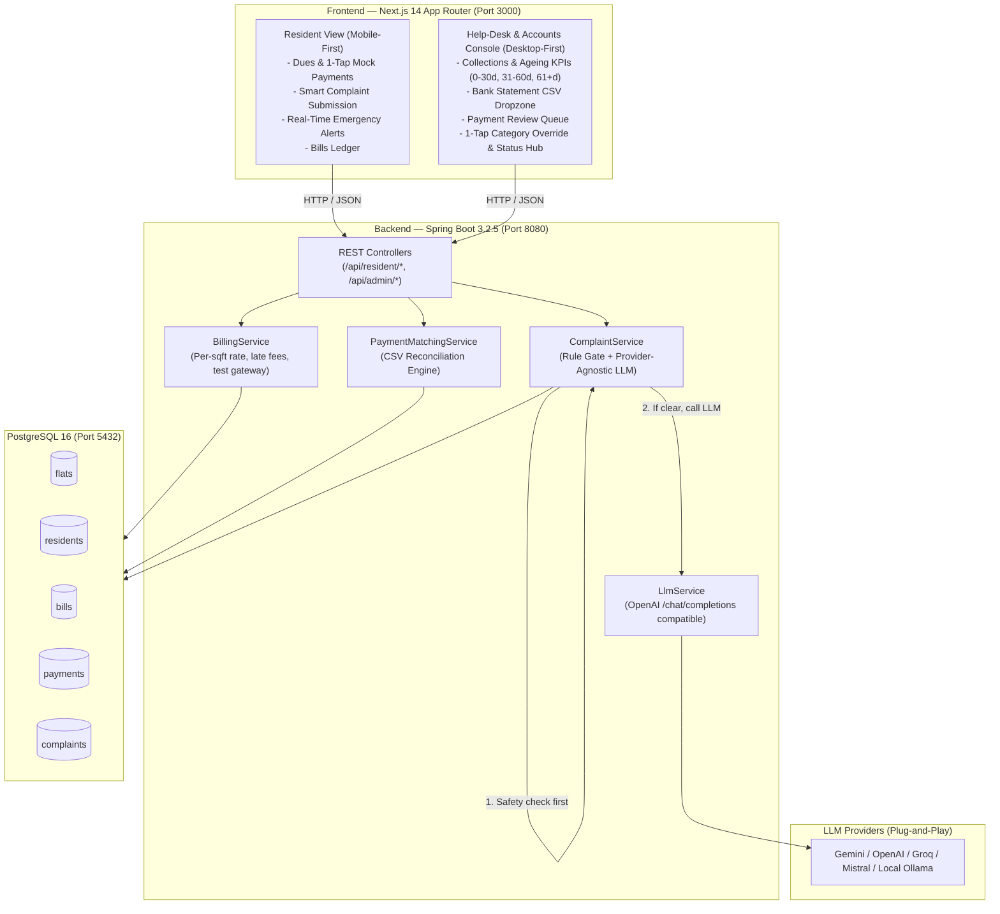

# Isocode Township Facility Management & Reconciliation MVP

> **Client:** Company A, Pune — Facility management company running a gated township of 2,400 apartments across 28 towers.  
> **Annual Maintenance Budget:** ₹22–26 Crore/year.  
> **Problem Solved:** ₹83.57 Lakh/year operational leakage (₹64.8L uncollected dues + ₹8.64L manual matching labor + ₹10.13L reopened complaint churn).

---

## 🏛️ System Architecture



---

## 🚀 Quick Start (Running the Stack)

### Prerequisites
* **Docker & Docker Compose** (compatible with ARM64/Apple Silicon and x86_64)  
  *OR* **Java 17+** and **Node.js 18+** for local development.

---

### Option A: Complete Docker Compose (1 Command)

1. **Clone & Configure Environment:**
   ```bash
   cd Isocode
   cp .env.example .env
   ```
   *(Optional: Set your `LLM_API_KEY` in `.env` if testing live AI classification. The safety keyword rule and graceful fallback work even without an API key!)*

2. **Boot All Services:**
   ```bash
   docker-compose up --build
   ```
   * Database: `localhost:5432` (Health-checked)
   * Backend API: `http://localhost:8080` (Flyway automatically seeds the sample flats)
   * Frontend: `http://localhost:3000`

---

### Option B: Fast Local Development (Hot-Reloading)

1. **Start PostgreSQL:**
   ```bash
   docker-compose up db -d
   ```

2. **Run Spring Boot Backend:**
   ```bash
   cd backend
   mvn spring-boot:run
   ```
   *(Runs on port 8080, automatically runs Flyway migrations `V1` and `V2`)*

3. **Run Next.js Frontend:**
   ```bash
   cd frontend
   npm install
   npm run dev
   ```
   *(Runs on `http://localhost:3000` with hot-reloading)*

---

## 💡 Core Features & How They Work

### 1. Bank Statement CSV Matching Engine (`PaymentMatchingService`)

Township accounts staff used to spend 60% of their time manually matching bank entries into Tally. The CSV matching engine automates this:

```
                          Bank Statement CSV Row
                         (Date, Desc, Amount, Ref)
                                    │
                                    ▼
                     Find Unpaid / Partial Bills
                matching Amount (or Base Amount)
                                    │
               ┌────────────────────┼────────────────────┐
               │                    │                    │
          0 Candidates         1 Candidate         >1 Candidates
               │                    │                    │
               │                    ▼                    ▼
               │              Mark as PAID         Disambiguation:
               │            (Auto-Reconciled)    Check flat number,
               │                    │           resident name, or
               │                    │           last-4 phone digits
               │                    │                    │
               │                    │            ┌───────┴───────┐
               │                    │            │               │
               │                    │        1 Match         Ambiguous
               │                    │            │               │
               │                    │            ▼               │
               │                    │       Mark as PAID         │
               ▼                    ▼            │               ▼
        REQUIRES_MANUAL_REVIEW  ←────────────────┴─────────── REQUIRES_MANUAL_REVIEW
        (Saved to accounts queue — NEVER posted automatically)
```

* **Zero-Leakage Guarantee:** Ambiguous rows where multiple flats owe the exact same amount and reference details are unclear are **never auto-posted**. They are placed in the **Manual Review Queue** for accounts approval.
* **1-Click Test Button:** In the Admin UI, click **"1-Click Test with Sample Statement"** to instantly test matching without needing to search your disk.

---

### 2. Smart Complaints & Safety Rule Override (`ComplaintService`)

Complaints follow a strict 4-step pipeline:

1. **Safety Keyword Gate (Always Fires First):**
   * Pre-screened for critical words: `fire`, `gas`, `gas leak`, `lift stuck`, `shock`, `electric shock`, `flood`, `burning`, `smoke`, `explosion`.
   * **Result:** Instantly assigned Category: `Safety`, Urgency: `CRITICAL`, Assigned: `Duty Manager`, Source: `RULE_BASED`. **Bypasses the LLM entirely.**
2. **Provider-Agnostic LLM Classification:**
   * If no safety keywords match, text is routed through `LlmService` using the standard OpenAI `/chat/completions` schema.
   * Categories: `Plumbing`, `Electrical`, `Civil`, `Housekeeping`, `Lift/Elevator`, `Pest Control`, `Security`, `Common Area`.
   * Urgencies: `LOW`, `MEDIUM`, `HIGH`.
3. **Graceful Fallback:**
   * If the LLM is unconfigured, unreachable, or times out, the complaint is saved as `Uncategorized` / `MEDIUM` (`MANUAL` source) and flagged for help-desk review. **The app never crashes.**
4. **Duplicate Detection:**
   * If another open complaint of the same category exists in the same tower within 48 hours, it is linked (`duplicateOf`). Duplicates are **linked, never closed**.

---

### 3. Provider-Agnostic LLM Configuration (`LlmService`)

Switch providers simply by updating environment variables in `.env`:

| Provider | `LLM_BASE_URL` | `LLM_MODEL` |
|---|---|---|
| **Google Gemini** *(Default)* | `https://generativelanguage.googleapis.com/v1beta/openai` | `gemini-1.5-flash` |
| **OpenAI** | `https://api.openai.com/v1` | `gpt-4o-mini` |
| **Groq (Llama 3)** | `https://api.groq.com/openai/v1` | `llama3-8b-8192` |
| **Mistral** | `https://api.mistral.ai/v1` | `mistral-small-latest` |
| **Local Ollama** | `http://localhost:11434/v1` | `llama3` *(No key needed)* |

---

## 🧪 Evaluator Test Walkthrough

The database is seeded with the exact sample data from the problem statement:

| Flat | Resident | Area | Sept Bill | Paid | Overdue | Open Complaints |
|---|---|---|---|---|---|---|
| **T07-1203** | Neeraj Kulkarni | 1,150 sq ft | ₹7,475 | ₹7,475 | 0 days | 0 |
| **T12-0408** | Swati Joshi (Tenant) | 980 sq ft | ₹6,370 | ₹0 | 47 days | 1 (Water Leak) |
| **T21-1601** | Aamir Shaikh | 1,640 sq ft | ₹10,660 | ₹5,000 | 18 days | 0 |

*(Rate: ₹6.50 / sq ft / month; Late fee applied per Maharashtra Cooperative Society bye-laws).*

### Test Scenario 1: Resident Dues & Mock Payment
1. Navigate to `http://localhost:3000/resident`.
2. Select **T12-0408 (Swati Joshi)** from the top-right switcher.
3. Notice outstanding due: **₹6,870** (Base: ₹6,370 + ₹500 late fee, 47 days overdue).
4. Tap **"Pay ₹6,870 Now"**.
5. Click **"Confirm & Pay"** in the mock gateway sheet.
6. The bill is immediately marked **PAID**, outstanding due updates to **₹0**, and a payment receipt reference is generated.

### Test Scenario 2: Emergency Safety Keyword Override
1. On the Resident view, switch to the **Complaints** tab.
2. In the text box, type: `"Lift stuck between 4th and 5th floor with residents inside"`.
3. Notice the live amber alert: *Safety Rule Triggered: "lift stuck"*.
4. Click **Submit Complaint**.
5. Observe result: Category: `Safety`, Urgency: `CRITICAL`, Assigned: `Duty Manager`, Source: `RULE_BASED`. (No LLM token was spent).

### Test Scenario 3: Bank CSV Statement Auto-Matching
1. Navigate to `http://localhost:3000/admin`.
2. Click the **CSV Matcher** tab.
3. Click **"1-Click Test with Sample Statement"**.
4. The system processes 5 statement transactions:
   * **Matched:** Swati Joshi (₹6,870) and Aamir Shaikh (₹5,660) are matched by amount + reference/name and posted to the ledger.
   * **Requires Review:** Unknown cash deposits and unrecognized transactions are securely moved to the **Review Queue**.
5. Switch to the **Review Queue** tab. Click **"Assign to Flat"** on any unmatched payment, pick a flat, and click **"Reconcile & Post"**.

### Test Scenario 4: 1-Tap Category Override & Status Hub
1. In the Admin console, switch to the **Smart Complaints** tab.
2. On any complaint, change the category dropdown (e.g. from *Plumbing* to *Civil*).
3. The change is saved instantly in the backend (`PATCH /api/admin/complaints/{id}/category`) with the source tagged as `MANUAL`.
4. Click **"Mark Resolved"** to transition the ticket lifecycle.

---

## 📡 REST API Reference

### Resident Endpoints (`/api/resident`)
* `GET /api/resident/dashboard?flatId={uuid}` — Home summary: dues, pending bills, open complaints.
* `GET /api/resident/bills?flatId={uuid}` — All historical bills for the flat.
* `POST /api/resident/payments/mock?flatId={uuid}` — Test mode payment `{ billId, amount }`.
* `GET /api/resident/complaints?flatId={uuid}` — All complaints raised by flat.
* `POST /api/resident/complaints?flatId={uuid}` — Submit new complaint `{ description }`.

### Admin Endpoints (`/api/admin`)
* `GET /api/admin/dashboard` — Collections KPIs, dues ageing (0-30d, 31-60d, 61+d).
* `GET /api/admin/flats` — All flats summary with resident names.
* `POST /api/admin/payments/upload` — Multipart CSV upload for statement reconciliation.
* `GET /api/admin/payments/review` — Unmatched / ambiguous payments queue.
* `POST /api/admin/payments/{id}/resolve` — Accounts manual resolution `{ flatId, billId }`.
* `GET /api/admin/complaints` — All township complaints feed.
* `PATCH /api/admin/complaints/{id}/status?status={status}` — Update status (`IN_PROGRESS`, `RESOLVED`, `REOPENED`).
* `PATCH /api/admin/complaints/{id}/category?category={category}` — 1-tap category override.

---

## 📁 Repository Structure

```
Isocode/
├── docker-compose.yml             # PostgreSQL 16 + Spring Boot + Next.js orchestration
├── README.md                      # Comprehensive project guide & documentation
├── .env.example                   # LLM provider configuration template
│
├── backend/                       # Spring Boot 3.2.5 (Java 17)
│   ├── Dockerfile                 # Multi-stage Maven + Temurin JRE build
│   ├── pom.xml                    # OpenCSV, Flyway, JPA, Jackson
│   └── src/
│       ├── main/java/com/isocode/
│       │   ├── controller/        # ResidentController, AdminController
│       │   ├── service/           # PaymentMatchingService, ComplaintService, LlmService, BillingService
│       │   ├── model/             # Flat, Resident, Bill, Payment, Complaint
│       │   ├── repository/        # Spring Data JPA repositories with fetch-joins
│       │   ├── dto/               # Type-safe Java records
│       │   └── config/            # CorsConfig, GlobalExceptionHandler
│       └── main/resources/
│           ├── application.yml    # App configuration & connection pool
│           └── db/migration/
│               ├── V1__init_schema.sql  # Database tables & indexes
│               └── V2__seed_data.sql    # Exact sample flats & bills
│
└── frontend/                      # Next.js 14 App Router + Tailwind CSS
    ├── Dockerfile                 # Multi-stage standalone Node.js runner
    ├── package.json               # Lucide icons, React 18, Tailwind
    ├── tailwind.config.ts         # Minimalist monochrome + blue accent theme
    └── src/
        ├── app/
        │   ├── page.tsx           # Township Portal & Problem Economics
        │   ├── resident/page.tsx  # Mobile-first resident experience (Max 2 taps)
        │   └── admin/page.tsx     # Desktop-first help-desk & accounts console
        ├── components/
        │   └── Navbar.tsx         # Unified township navigation
        └── lib/
            ├── api.ts             # Typed REST API client
            └── types.ts           # TypeScript interfaces & sample data
```

---

## ⚖️ Compliance & Security
* **DPDP Act 2023:** Compliant architecture for resident PII and retention.
* **Maharashtra Cooperative Societies Act:** Accurate late fee calculation and dues ageing categorization.
* **Prompt Injection Resilience:** Strict structured JSON parsing with markdown stripping and parameter validation.

